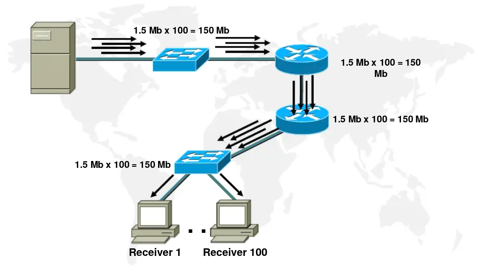
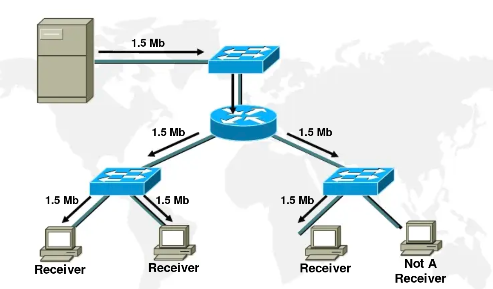
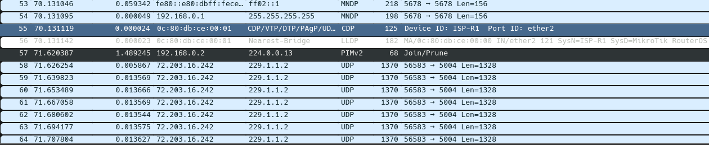
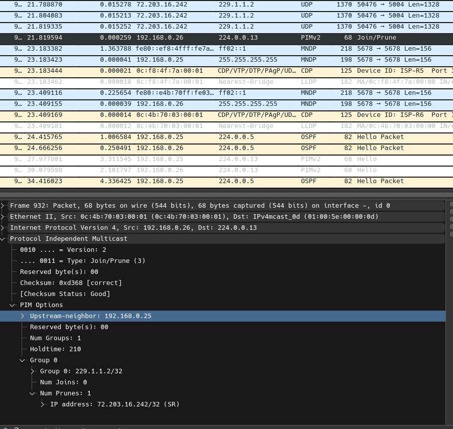
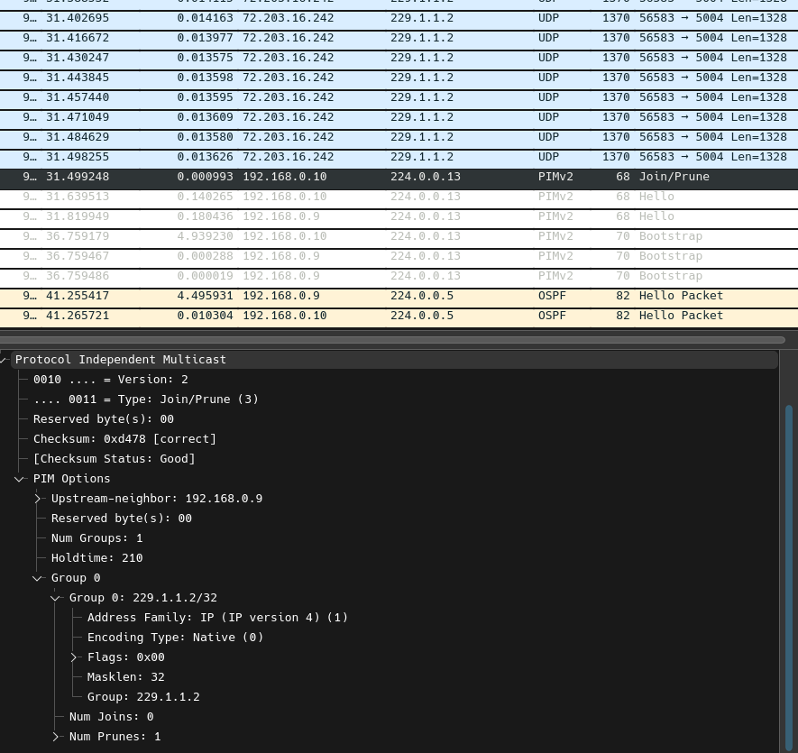
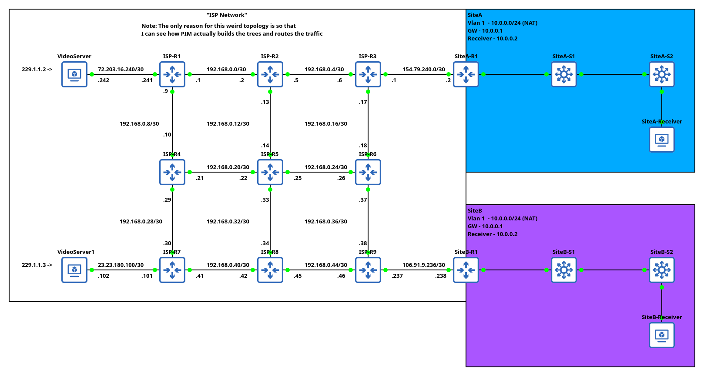
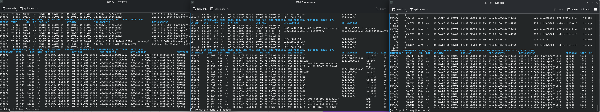

# IGMP-Basic

## Problem Statement
Assume you are an ISP, your client has a Smart TV live-streaming solution for let's say 100 TVs. <br>
Normally, each Smart TV would request the server for exactly the same data stream from the server (Assuming each Smart TV is watching the same live-channel) <br>
This results in 99 streams of effectively duplicate data that uses extra bandwidth without particularly great reason <br>

Note: This is different to just watching a netflix or whatever, as each user might be watching a different video which effectively is a totally different data stream. This scenario assumes that the Smart TVs watch exactly the same stream source. Like Smart TVs are just used to show the same ads on all TV's like in a mall
 <br>
Image source https://www.scribd.com/doc/294358090/IGMP-introduction-ppt

## Simplified Solution
This scenario assumes, that the server is located somewhere inside ISP network and the Smart TV provider would be willing to re-configure it to multicast but aside from that logic holds. <br> <br>
Instead of each Smart TV requesting data stream from the server. What if the server would be sending one stream of data that multiple Smart TVs would be able to subscribe to. <br>
 <br>
Image source https://www.scribd.com/doc/294358090/IGMP-introduction-ppt

## Multicast
Multicast solves the exact issue discussed. It allows us to send data to a group of devices. The disadvantage there is that it's a stream of data that will be exactly the same for all the devices which is not always desirable <br> 
The important distinction there is difference between Layer 2 and Layer 3 multicasting <br>
Layer 2 - Multicasting strictly operates on MAC address and well Layer 2 within the same VLAN <br>
Layer 3 - Multicasting strictly operates on Multicast IP addresses (range 224.0.0.0 - 239.255.255.255, with some ranges being reserved for experimental use and other shenanigans like usually there is rfc for it) and is not limited to devices on the same VLAN (Because it's layer 3) <br>

There is not really a lot to be said about multicast aside from that it looks like ipv4 address. But I would think of that as a Group membership ID not a source/destination address

## IGMP
IGMP (Internet Group Management Protocol) is a protocol that handles device joining/leaving a multicast group <br>

IGMPv1 - Includes General Query (asking all devices what are their Multicast Groups), Membership Report (Response to General Query) <br>
IGMPv2 - Adds Group-Specific Query (asking what devices are member of specific group), Leave Group Message <br>
IGMPv3 - Adds Filtering mechanism which allows devices to join a Multicast Group but only from source of X.X.X.X address <br>

MLD - Is an IGMP equivalent for IPV6

### Joining a Group
When a device wants to join a group it sends a Membership Report to a Multicast Address it wants to be a part of. This informs a router that there is a new member that wants to be a part of a Multicast group. Which then allows the router to forward the multicast traffic onto the interface/vlan <br>
It's important to highlight there that; 
1. When there is no existing members of a multicast group on a vlan/interface. The router will not forward the multicast traffic from a sender. Because there is no devices subscribed on an interface/vlan the router just knows to not send there multicast traffic. This means when a device sends Join Membership Report the router then starts forwarding the multicast traffic. 
2. When an additional member wants to join a group, but the router is already forwarding the multicast traffic. There is not a lot happening from routers perspective as it's already forwarding multicast traffic to the interface/vlan as previous members already asked for the traffic. 

### Leaving a Group
A device can decide to leave a group. It will send a Leave Group to a multicast address 224.0.0.2
1. The device was the last member of a group on an interface/vlan. This means there is no more devices being a member of this group. Hence, router stops sending multicast traffic
2. There is more devices actively being member of the multicast group. The router does nothing still forward the multicast traffic. 

Note: Router does not track amount of active devices. So after Leave Group is sent, Router will send a Query message but on specific multicast address. And when no responses will arrive back (no devices being member of this multicast group). Router stops forwarding this multicast group

### Monitoring Membership Status
Every X seconds router sends a General Query to a Multicast Address of 224.0.0.1 <br>
1. When a router gets no response from the devices. The Multicast groups get terminated and the forwarding of multicast group gets stopped. Exactly the same as when the last device would leave the group. The router stops forwarding <br>
2. When a router gets response from a device. Nothing changes the router keeps forwarding the multicast group

Note: On one interface/vlan a device can be a member of multiple groups. Stopping forwarding means that the forwarding for a specific group without devices gets stopped. While the other still active Multicast Groups stay forwarded.

### IGMP Snooping
IGMP snooping is strictly configured on switches <br>
With IGMP snooping, the switch is actively looking at IGMP packets and checking the membership of a port. It works very similar to router in this case as;
When client joins the multicast group the switch starts to send the data through the port <br> 
If client is not a member of the multicast group. There is no reason to send multicast traffic to the port as the client is not subscribed to it so any way it would be discarding the traffic. (Reduces amount of unnecessary traffic to end devices) <br>
When IGMP snooping is not configured on a switch. Switch will just re-send all the multicast traffic on the vlan it was received to all the ports the vlan is member of. Which is not really efficient. As end-device needs to process this traffic for no reason.  

## PIM
PIM (Protocol Independent Multicast) has three functions; 
1. Tracks which Routers are members of a Multicast Group (When a device requests to be a part of a Multicast Group, The Router inherently becomes part of this group. This is what PIM tracks)
2. PIM also handles forwarding the traffic using RPF (Reverse Path Forwarding). Which generates tree like structure that prevents Multicast traffic from looping and is used to make forwarding decisions. In both cases of RPT or SPT the underlying addresses are used to determine the tree structure (It's being influenced by OSPF cost for example). But the actual traffic doesn't contain a destination address of a router just a multicast address of a group.   
3. Translates/Bridges the IGMP messages which are destined to local router only to PIM messages that are handled accordingly depending on if it's Dense or Sparse mode. (Effectively PIM between Routers, IGMP local interface/vlan)

RP – Rendezvous Point has two functions;
1. Is the point where routers register to which multicast groups they are members of (or de-register when no longer part of)
2. Is the root of the tree for the RPF, It's placement is very important in a network as it's used to determine the optimized multicast paths (at least when running without SPT). [Very similar to STP, bad STP root placement and weird things can be happening]

Note: There can be multiple RPs on a network. RP can be configured per multicast group (Multiple various RPs handling multiple different Multicast Groups)

BSR - Bootstrap Router, RP needs to be manually configured on each router in a network. (Which is not scalable) Without RP configured a router doesn't know what to do with multicast traffic, and it just won't work. BSR is just a register of RPs in a network that all the other routers can pull automatically without manual configuration.

Note: A BSR doesn't need to be an RP. But it can be.

### PIM Operation Modes
Dense - Multicast traffic will be sent to all routers, routers can opt out after receiving the traffic (Not really optimal. Opt out logic) <br>
Sparse - Multicast traffic will be sent to routers that specifically asked for particular group (Opt in logic)

In dense mode RP router is not used. As the traffic will be sent to all the routers anyway they have to opt out <br>
Where as in Sparse mode RP is needed because this is the actual registry between routers on which router is subscribed to which multicast group.

### PIM Trees/SPT
RPT (Rendezvous Point Tree), is a shared tree where all the paths are calculated from the RP. And all the traffic flows via RP (which can be inefficient) <br>
SPT (Shortest Path Tree), is a Source Tree meaning that the paths are calculated from source to destination (the least amount of Hops/Metric/Cost depending on underlying routing protocol used) [was enabled by default on Mikrotik] <br>

#### RPT
When a receiver joins a multicast group. Senders will always send the traffic to RP and then RP sends the traffic to receivers. Effectively it's possible for traffic to go via unoptimized paths <br>
This is where RP placement is very important

#### SPT/Crappy Explanation of RPF
When a receiver joins a multicast group. The initial flow of traffic will go through RP. But when SPT is enabled on routers. Each router in a path can decide weather there is a better flow for the traffic and adjust accordingly <br>
This means that it's very similar to DMVPN/NHRP where the first flow needs to register Hub (in this example RP). And then the traffic is optimized after the initial flow straight to the destination rather than Hub<br>

Note: SPT is enabled/disabled per router in a path. Not on the sender/receiver router <br>
Note2: The routers don't decide by themselves when to optimize the traffic. <br>
Last router (receiver) sends PIM Join message with (Source,Multicast Group) to the next hop router. From which the next hop router runs the RPF and picks next hop from it's routing table. Setting SPT flag (internally, so it knows it was already optimized). Resending the (Source, Multicast Group) to the next hop router <br>
Effectively this recursively iterates till the source (sender) router <br>
When the (Source, Multicast Group) reaches the sender. The sender starts forwarding the multicast traffic directly to the receiver (it also keeps sending traffic to RP) <br>
And then when the receiver receives the traffic directly it sends a PIM prune message to the RP. RP stops sending the traffic to the receiver (because it communicates now directly with the sender). And if there is no more receivers the RP sends a message to the sender to stop sending the multicast traffic to RP (sender directly communicates with receiver but RP doesn't need to see that traffic as there is direct communication) <br>
TLDR; this is like reverse search in binary tree with the update messages being sent to the RP. (Hence, the name Reverse Path Forwarding I guess) <br>
Note3: When I am referring to "direct communication" it's more of a "good" direction. The multicast traffic send doesn't have a destination (it has destination of multicast group). Because Routers performed the Reverse Path Forwarding, all is happening from this point is "send it this way it should reach the destination in an optimized path"

Note4: While the explanation above is not the greatest I think I got the concept and the wireshark dump confirms it <br>
RPF touches the sender. The sender starts to send multicast traffic via the optimized path <br>
 <br>
Receiver sends Join/Prune request (to leave as there is other optimized path so RP doesn't need to send anything) <br>
 <br>
RP sends the Join/Prune (to leave because there is no more receivers attached to RP so there is no reason for multicast traffic to be send to RP) <br>
 <br>
And then traffic only flows via the optimized path <br>

## LAB


Configs are available in the ``config/`` directory <br>

### Configuration
1. Used docs from Mikrotik https://help.mikrotik.com/docs/spaces/ROS/pages/61767728/PIM-SM
2. Switches are not configured at all they have snooping enabled by default. When I disable it the switches just start sending the multicast traffic on all ports (because every port is in vlan 1)
3. Started with Allocating IPs for routers and configuring OSPF there is nothing fancy behind it. It just works

#### PIM Instance Configuration
```
/routing/pimsm/instance/add name=pimsm-instance-1
/routing/pimsm/interface-template/add interfaces=ether1,ether2 instance=pimsm-instance-1
```
PIMSM needs to be enabled on all interfaces expecting multicast traffic. Including the interfaces facing the VideoServers and the Vlan 1s <br>

#### BSR + RP configuration
I opted to configure BSR and RP on the same Router (R5). I configured loopback interface + added it to pism instance (otherwise it doesn't work). 
```
/routing/pimsm/instance/add name=pimsm-instance-1
/routing/pimsm/bsr/candidate/add address=192.168.255.254%lo instance=pimsm-instance-1
/routing/pimsm/bsr/rp-candidate/add address=192.168.255.254%lo group=229.0.0.0/4 instance=pimsm-instance-1
/routing/pimsm/interface-template/add instance=pimsm-instance-1 interfaces=ether1,ether2,ether3,ether4,lo
```
Aside of OSPF this is literary the whole configuration. <br>
Also, the group ``229.0.0.0/4`` is what the RP covers. For a lab this is good enough 

### Running Video Servers
 <br>
``tool/sniffer quick`` shows traffic on R2 and R8 where RP (R5) is clearly not forwarding multicast traffic (aside of PIM messages)
#### VideoServer Paths
```
[admin@ISP-R1] > routing/pimsm/uib-g/print 
Columns: INSTANCE, GROUP, RP, RPF
# INSTANCE          GROUP      RP               RPF               
0 pimsm-instance-1  229.1.1.2  192.168.255.254  192.168.0.2%ether2
[admin@ISP-R1] > routing/pimsm/uib-sg/print 
Flags: K - KEEPALIVE; S - SPT-BIT
Columns: INSTANCE, GROUP, SOURCE
#    INSTANCE          GROUP      SOURCE       
0 KS pimsm-instance-1  229.1.1.2  72.203.16.242
[admin@ISP-R1] > 
```
```
[admin@ISP-R2] > routing/pimsm/uib-g/print 
Columns: INSTANCE, GROUP, RP, RPF
# INSTANCE          GROUP      RP               RPF                
0 pimsm-instance-1  229.1.1.2  192.168.255.254  192.168.0.14%ether3
[admin@ISP-R2] > routing/pimsm/uib-sg/print 
Flags: K - KEEPALIVE; S - SPT-BIT
Columns: INSTANCE, GROUP, SOURCE, RPF
#    INSTANCE          GROUP      SOURCE         RPF               
0 KS pimsm-instance-1  229.1.1.2  72.203.16.242  192.168.0.1%ether1
[admin@ISP-R2] > 
```
```
[admin@ISP-R3] > routing/pimsm/uib-g/print 
Columns: INSTANCE, GROUP, RP, RPF
# INSTANCE          GROUP      RP               RPF                
0 pimsm-instance-1  229.1.1.2  192.168.255.254  192.168.0.18%ether3
[admin@ISP-R3] > routing/pimsm/uib-sg/print 
Flags: K - KEEPALIVE; S - SPT-BIT
Columns: INSTANCE, GROUP, SOURCE, RPF
#    INSTANCE          GROUP      SOURCE         RPF               
0 KS pimsm-instance-1  229.1.1.2  72.203.16.242  192.168.0.5%ether2
[admin@ISP-R3] > 
```
```
[admin@SiteA-R1] > routing/pimsm/uib-g/print 
Columns: INSTANCE, GROUP, RP, RPF
# INSTANCE          GROUP      RP               RPF                
0 pimsm-instance-1  229.1.1.2  192.168.255.254  154.79.240.1%ether1
[admin@SiteA-R1] > routing/pimsm/uib-sg/print 
Flags: K - KEEPALIVE; S - SPT-BIT
Columns: INSTANCE, GROUP, SOURCE, RPF
#    INSTANCE          GROUP      SOURCE         RPF                
0 KS pimsm-instance-1  229.1.1.2  72.203.16.242  154.79.240.1%ether1
[admin@SiteA-R1] > 
```
#### VideoServer 1 Paths
```
[admin@ISP-R7] > routing/pimsm/uib-g/print 
Columns: INSTANCE, GROUP, RP, RPF
# INSTANCE          GROUP      RP               RPF                
0 pimsm-instance-1  229.1.1.3  192.168.255.254  192.168.0.29%ether3
[admin@ISP-R7] > routing/pimsm/uib-sg/print 
Flags: K - KEEPALIVE; S - SPT-BIT
Columns: INSTANCE, GROUP, SOURCE
#    INSTANCE          GROUP      SOURCE       
0 KS pimsm-instance-1  229.1.1.3  23.23.180.102
[admin@ISP-R7] > 
```
```
[admin@ISP-R8] > routing/pimsm/uib-g/print 
Columns: INSTANCE, GROUP, RP, RPF
# INSTANCE          GROUP      RP               RPF                
0 pimsm-instance-1  229.1.1.3  192.168.255.254  192.168.0.33%ether1
[admin@ISP-R8] > routing/pimsm/uib-sg/print 
Flags: K - KEEPALIVE; S - SPT-BIT
Columns: INSTANCE, GROUP, SOURCE, RPF
#    INSTANCE          GROUP      SOURCE         RPF                
0 KS pimsm-instance-1  229.1.1.3  23.23.180.102  192.168.0.41%ether2
[admin@ISP-R8] > 
```
```
[admin@ISP-R9] > routing/pimsm/uib-g/print 
Columns: INSTANCE, GROUP, RP, RPF
# INSTANCE          GROUP      RP               RPF                
0 pimsm-instance-1  229.1.1.3  192.168.255.254  192.168.0.37%ether3
[admin@ISP-R9] > routing/pimsm/uib-sg/print 
Flags: K - KEEPALIVE; S - SPT-BIT
Columns: INSTANCE, GROUP, SOURCE, RPF
#    INSTANCE          GROUP      SOURCE         RPF                
0 KS pimsm-instance-1  229.1.1.3  23.23.180.102  192.168.0.45%ether2
[admin@ISP-R9] > 
```
```
[admin@SiteB-R1] > routing/pimsm/uib-g/print 
Columns: INSTANCE, GROUP, RP, RPF
# INSTANCE          GROUP      RP               RPF                
0 pimsm-instance-1  229.1.1.3  192.168.255.254  106.91.9.237%ether1
[admin@SiteB-R1] > routing/pimsm/uib-sg/print 
Flags: K - KEEPALIVE; S - SPT-BIT
Columns: INSTANCE, GROUP, SOURCE, RPF
#    INSTANCE          GROUP      SOURCE         RPF                
0 KS pimsm-instance-1  229.1.1.3  23.23.180.102  106.91.9.237%ether1
[admin@SiteB-R1] > 
```

Note: Changing OSPF interface priority well changes the route. But it also changes the paths on pimsm <br>

## TODO
It looks like it would be good to revisit this on a bigger lab <br>
- Redundancy
- Security
- Load Balancing
- IGMPv3 source filtering